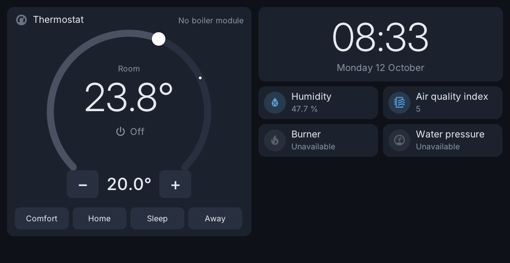
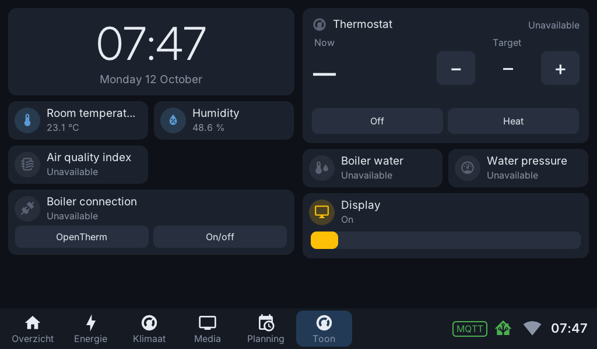
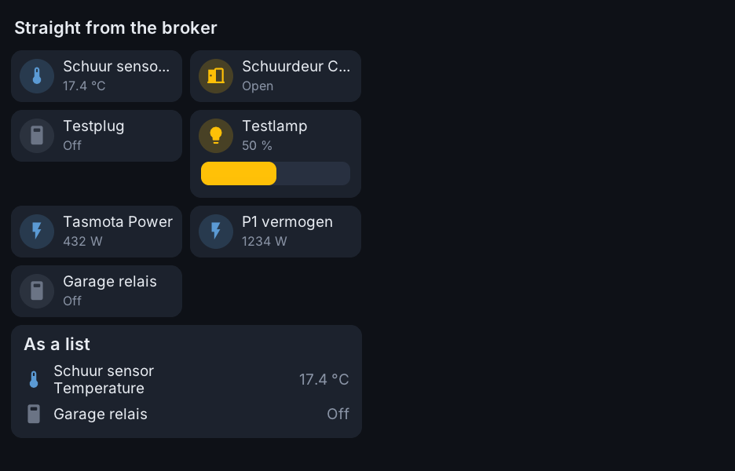
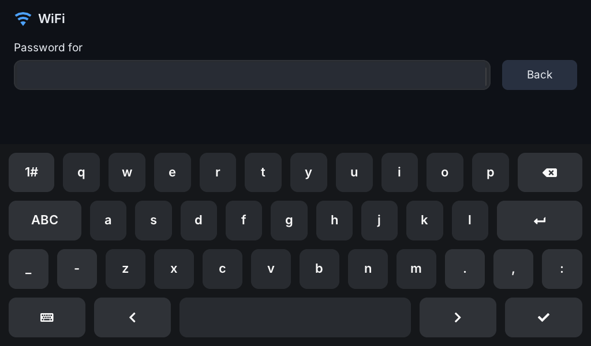
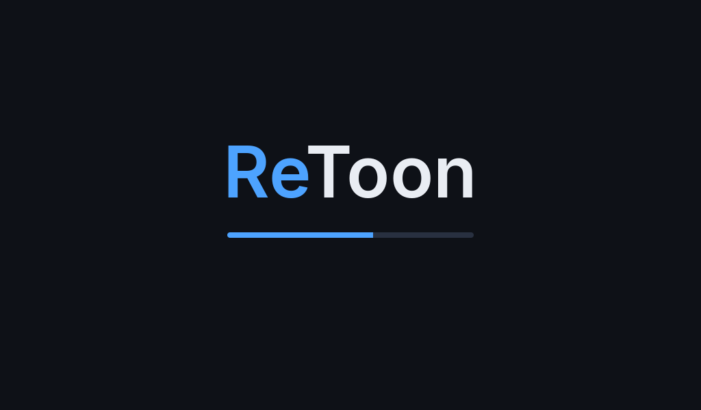
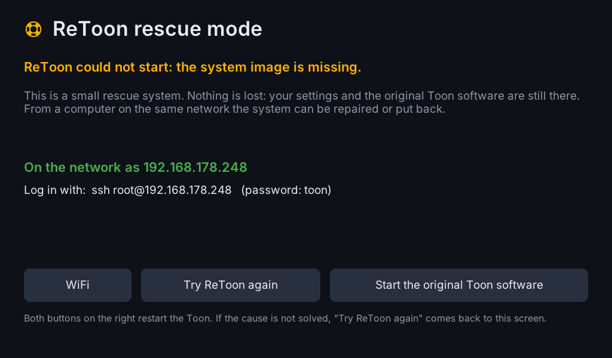
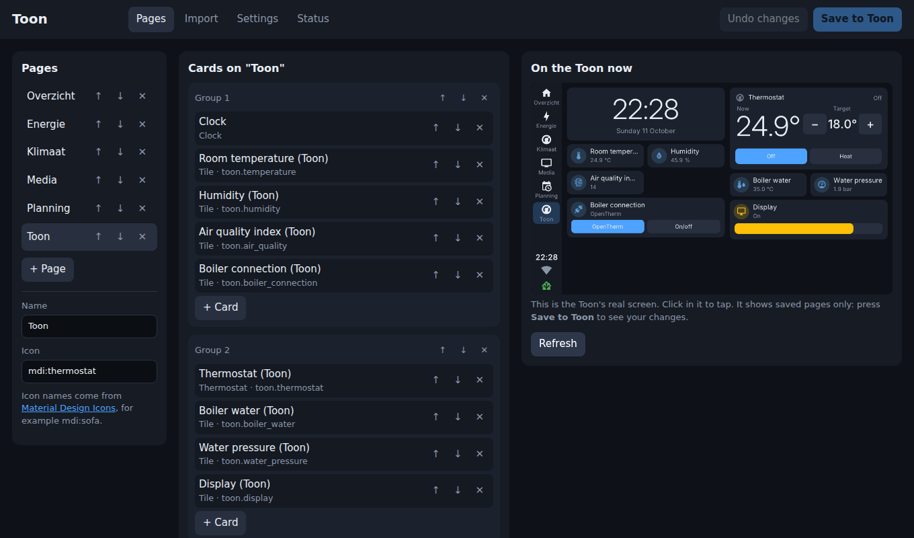
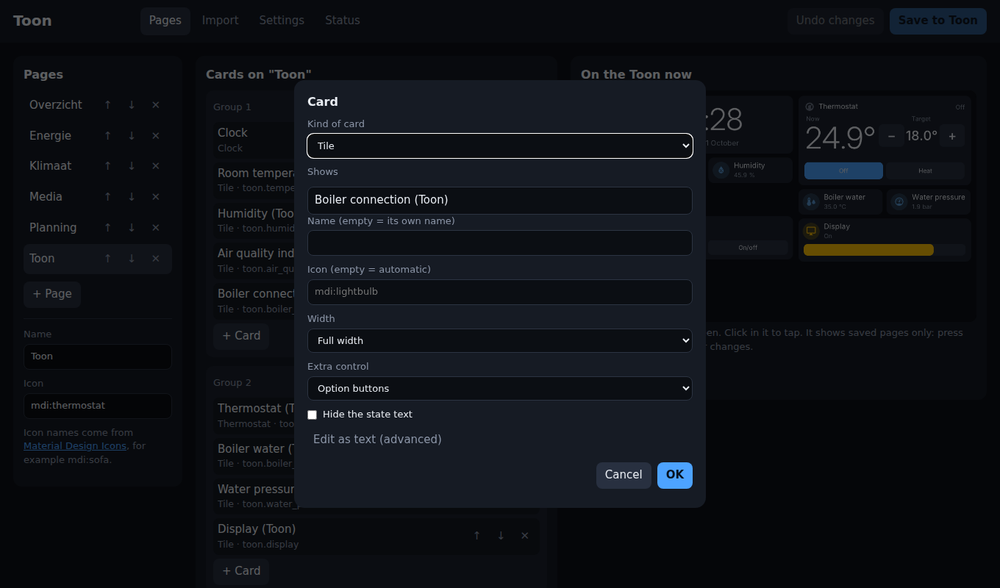
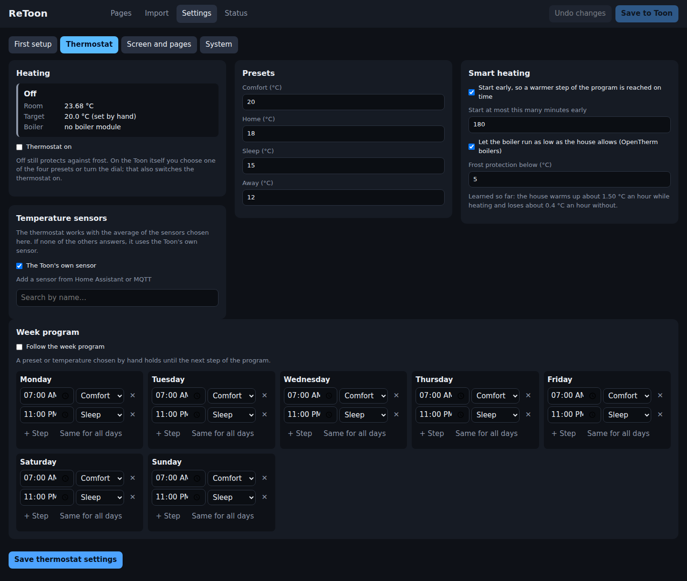

# ReToon setup app for the original Toon 2 software

An app for a rooted Toon 2 running the original software with the
ToonSoftwareCollective `tsc` helper. It puts ReToon in place next to the
original software and restarts the Toon into it. ReToon turns a Toon 2 into
an open wall panel and thermostat that works with Home Assistant.

Nothing of the original software is removed. After installing, ReToon runs
until the Toon restarts; a restart goes back to the original software unless
"Always start ReToon" is switched on in the ReToon web interface (Settings,
System, Starting up). That way you can try ReToon first and keep it once it
does what you want.

## What ReToon does

ReToon replaces the Toon's software with its own system. Everything is set up
from a browser on your phone or computer: the Toon's info screen (the (i) in
the bar at the bottom) shows the address and the password, and a QR code that
opens the web interface already logged in.

### On the Toon itself, also without Home Assistant or internet

- **Thermostat.** It runs on the Toon and keeps working when the network or
  Home Assistant is down: dial with the room temperature, presets (comfort,
  home, sleep, away), a week program, starting early so the room is warm on
  time, and frost protection, also when the thermostat is off. It drives the
  Toon's boiler module (OpenTherm, or the on/off contact). The installer takes
  over your preset temperatures and week program from the original software;
  the heating itself stays off until you switch it on. *Not yet tested with a
  real boiler.*
- **The Toon's own sensors**: room temperature, humidity, light and air
  quality (the air-quality value is not calibrated yet).
- **The screen**: pages with cards, a clock, and the WiFi setup.
- **Apps** that run on the Toon itself, like SpotEnergy (dynamic electricity
  prices; needs internet, not Home Assistant).
- **The web interface**: pages and cards, all settings, the thermostat's
  presets and week program.

### Together with Home Assistant

- **Pages show your Home Assistant devices** live, and a tap switches them:
  lights, switches, sensors, other thermostats. Cards use Home Assistant's own
  dashboard format, and whole pages can be copied over from a Home Assistant
  dashboard. The Toon connects to Home Assistant itself (log in through Home
  Assistant's login page, or a token).
- **The Toon in Home Assistant** (through your MQTT broker, with Home
  Assistant's MQTT discovery, so it shows up by itself):
  its sensors, the thermostat (temperature, presets, on/off), the boiler
  values and the display's brightness. So Home Assistant automations can
  control the thermostat, while the thermostat itself keeps running on the
  Toon.
- **Room temperature from elsewhere**: the thermostat can use sensors from
  Home Assistant or MQTT (averaged) instead of the Toon's own; when those are
  gone it falls back to its own sensor.
- **Z-Wave** (switched on in the web interface): the Toon's built-in Z-Wave
  controller is offered on the network to Z-Wave JS in Home Assistant, which
  then handles the Z-Wave devices (switches, plugs, the Quby meter adapter).
  The devices stay in the Toon's Z-Wave network.
- Without Home Assistant, pages can also show and switch values straight from
  an MQTT broker.

### Not (yet) in ReToon

Z-Wave devices handled by the Toon itself (without Z-Wave JS), reading the
meter adapter or a P1 smart meter on the Toon itself, Zigbee devices, graphs,
camera and media cards, and the energy and service features of the original
Eneco software.

## What ReToon looks like

On the Toon itself:

| | |
|---|---|
|  |  |
| The home page: thermostat dial with presets, clock and the Toon's own sensors | Pages like in Home Assistant, with the page bar at the bottom |
|  |  |
| Values and switches straight from an MQTT broker | WiFi is set up on the screen itself |
|  |  |
| While starting | Rescue mode, when the system cannot start |

From a browser, the Toon's own web interface:

| | |
|---|---|
|  |  |
| Pages and cards, with the Toon's real screen next to them | One card |

Thermostat settings: presets, week program, temperature sensors.

## Files

- `RetoonApp.qml`, `RetoonTile.qml`, `RetoonScreen.qml`: a tile and one screen
  with a status line and a button.
- `thermostat.awk`: turns the original software's thermostat settings into
  ReToon's.
- `retoon.sh`: does the work. The app writes `check` or `install` to
  `/tmp/retoon.request` and `external-retoon` to `/tmp/tsc.command`; the
  helper then runs this script as root. Progress is in `/tmp/retoon.status`
  (JSON) and `/var/log/retoon.log`.
- `retoon.tar.gz`: ReToon itself, the five files a Toon needs (kernel, device
  tree, initrd, system image, boot script). The app unpacks what is missing
  from it; nothing is downloaded.
- `files.sha256`: those five files with their checksums. Files already on the
  Toon with the right checksum are kept, and every unpacked file is checked.
- `source.url` (optional, not included): one line with an address to fetch
  the files from, as `<address>/<file name>`, used only when `retoon.tar.gz`
  is not there.

## What the button does

1. Unpacks the files that are missing from `retoon.tar.gz` and checks them.
2. Puts the system image on the data partition (`/mnt/data/toon-os/`).
3. Puts kernel, device tree and initrd on the third partition, next to the
   recovery files.
4. Takes over the WiFi settings of the Toon, and the thermostat's preset
   temperatures and week program (`thermostat.awk`).
5. Copies the firmware of the WiFi and Bluetooth chip from the original
   software to the data partition (ReToon images do not contain it).
6. Writes `boot.scr` to the first partition.
7. Restarts the Toon into ReToon. The next restart after that goes back to
   the original software, until "Always start ReToon" is switched on.

## Installing by hand

Copy these files to `/qmf/qml/apps/retoon` and restart the screen program.
`retoon.sh check` and `RETOON_NO_REBOOT=1 retoon.sh install` can also be run
from a shell.

## Status

Test version. Tested on Toon 2 units: all steps including the restart into
ReToon with WiFi and Bluetooth working, started from the button on the
screen, and taking over WiFi and the thermostat program. The thermostat part
of ReToon has never been connected to a real boiler.
